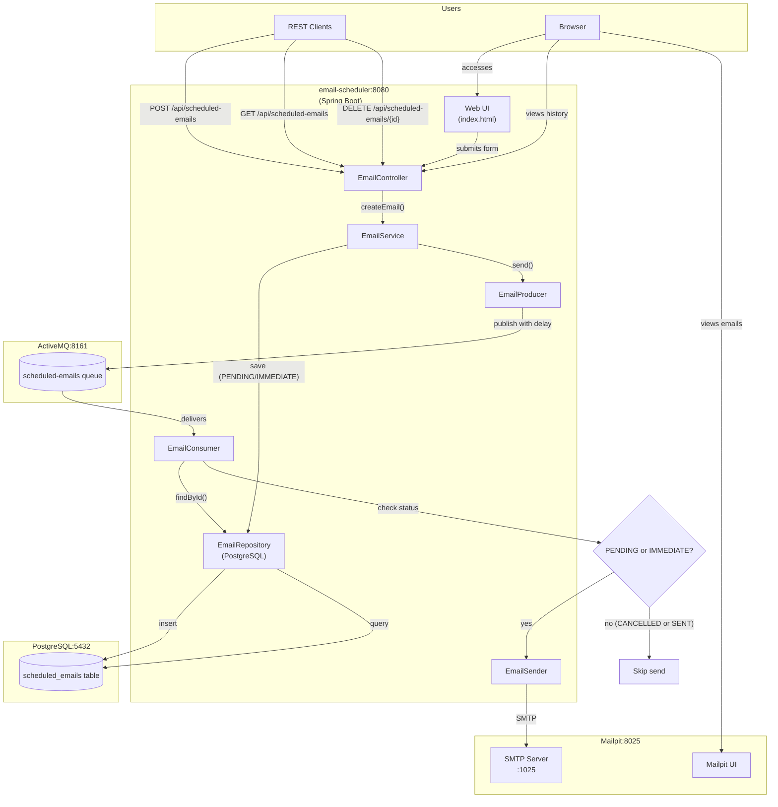
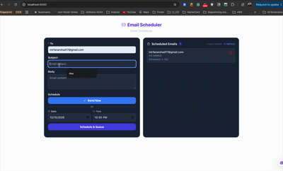

# spring-boot-email-schedualer


The goal of this project is to demonstrate how to implement an email scheduling application using [`Spring Boot`](https://docs.spring.io/spring-boot/index.html), [`ActiveMQ`](https://activemq.apache.org/), [`PostgreSQL`](https://www.postgresql.org/), and [`Mailpit`](https://mailpit.axllent.org/). The application allows users to send emails immediately or schedule them for a later time. It also provides a web UI to view the history of scheduled emails and cancel pending ones.

## Project Overview



## Applications

- ### spring-boot-email-schedualer

  `Spring Boot` Java web application that provides REST API and a web UI for sending emails immediately or scheduling emails. It uses `ActiveMQ` as the message broker to handle email scheduling, `PostgreSQL` for persistence (tracking email status: `PENDING`, `IMMEDIATE`, `SENT`, `CANCELLED`, `FAILED`), and `Mailpit` as a local SMTP server to capture and display sent emails.

  Endpoints:
  ```text
    POST /api/scheduled-emails -d {"to": "...", "subject": "...", "body": "...", "delayInMillis": ...}
     GET /api/scheduled-emails
  DELETE /api/scheduled-emails/{id}
  ```

## Prerequisites

- [`Java 25`](https://www.oracle.com/java/technologies/downloads/#java25) or higher;
- A containerization tool (e.g., [`Docker`](https://www.docker.com), [`Podman`](https://podman.io), etc.)

## Start Docker Compose services

In a terminal and inside the `spring-boot-email-schedualer` root folder run:
```bash
podman compose up -d
```

## Running application using Maven

In a terminal and inside the `spring-boot-email-schedualer` root folder, run the command below:
```bash
./mvnw clean spring-boot:run --projects spring-boot-email-schedualer
```

## Simulation

- Open a browser and access `Mailpit` at http://localhost:8025
- Open another browser and access `spring-boot-email-schedualer` application at http://localhost:8080
- Fill in the email scheduling form. You can send the email immediately or schedule it for a later time.
- Emails sent with "Send Now" do not appear in the history panel.
- You can view all scheduled (pending) emails in the history panel below the form.
- You can cancel any pending scheduled email by clicking the cancel (X) button.
- Check the `Mailpit` at the scheduled time to see the received email.

## Demo



## Useful links

- **ActiveMQ**

  - Access http://localhost:8161
  - Click `Manage ActiveMQ broker`.
  - To log in, use `admin` for both username and password.

- **Mailpit**

  - Access http://localhost:8025

- **PostgreSQL**

  ```bash
  docker exec -it postgres psql -U postgres -d emaildb
  select * from scheduled_emails;
  ```

## Shutdown

To stop and remove Docker Compose containers, network, and volumes, go to a terminal and, inside the `spring-boot-email-schedualer` root folder, run the following command:
```bash
podman compose down -v
```

## Running Tests

In a terminal and inside the `spring-boot-email-schedualer` root folder, run the following command:
```bash
./mvnw clean test
```

## Code Formatting

Uses [Spotless Maven Plugin](https://github.com/diffplug/spotless/tree/main/plugin-maven) + [Google Java Format](https://github.com/google/google-java-format) (Java) and [Prettier](https://prettier.io/) (JS/HTML) for automated formatting.

- **Check formatting:**

  ```bash
  ./mvnw spotless:check
  ```

- **Auto-fix formatting:**

  ```bash
  ./mvnw spotless:apply
  ```

Formatting is enforced automatically during `./mvnw test`.

## How to optimize the GIF in the documentation folder

## Support


Reach out to me at one of the following places! For project and technical assistance,
[Email](mailto:mirfanarshad17@gmail.com)
[GitHub](https://github.com/m-irfan-arshad) | [LinkedIn](https://www.linkedin.com/in/muhammad-irfan-arshad-a8427a71/)

### Reference Documentation

For further reference, please consider the following sections:

* [Official Apache Maven documentation](https://maven.apache.org/guides/index.html)
* [Spring Boot Maven Plugin Reference Guide](https://docs.spring.io/spring-boot/4.1.1/maven-plugin)
* [Create an OCI image](https://docs.spring.io/spring-boot/4.1.1/maven-plugin/build-image.html)
* [Spring for Apache ActiveMQ 5](https://docs.spring.io/spring-boot/4.1.1/reference/messaging/jms.html#messaging.jms.activemq)
* [Spring for Apache ActiveMQ Artemis](https://docs.spring.io/spring-boot/4.1.1/reference/messaging/jms.html#messaging.jms.artemis)
* [Spring Data JPA](https://docs.spring.io/spring-boot/4.1.1/reference/data/sql.html#data.sql.jpa-and-spring-data)
* [Spring Boot DevTools](https://docs.spring.io/spring-boot/4.1.1/reference/using/devtools.html)
* [Java Mail Sender](https://docs.spring.io/spring-boot/4.1.1/reference/io/email.html)
* [Validation](https://docs.spring.io/spring-boot/4.1.1/reference/io/validation.html)
* [Spring Web](https://docs.spring.io/spring-boot/4.1.1/reference/web/servlet.html)

### Guides

The following guides illustrate how to use some features concretely:

* [Java Message Service API via Apache ActiveMQ Classic.](https://spring.io/guides/gs/messaging-jms/)
* [Messaging with JMS](https://spring.io/guides/gs/messaging-jms/)
* [Accessing Data with JPA](https://spring.io/guides/gs/accessing-data-jpa/)
* [Validation](https://spring.io/guides/gs/validating-form-input/)
* [Building a RESTful Web Service](https://spring.io/guides/gs/rest-service/)
* [Serving Web Content with Spring MVC](https://spring.io/guides/gs/serving-web-content/)
* [Building REST services with Spring](https://spring.io/guides/tutorials/rest/)

### Maven Parent overrides

Due to Maven's design, elements are inherited from the parent POM to the project POM.
While most of the inheritance is fine, it also inherits unwanted elements like `<license>` and `<developers>` from the
parent.
To prevent this, the project POM contains empty overrides for these elements.
If you manually switch to a different parent and actually want the inheritance, you need to remove those overrides.


## License

This project is licensed under the [MIT License](./LICENSE).
